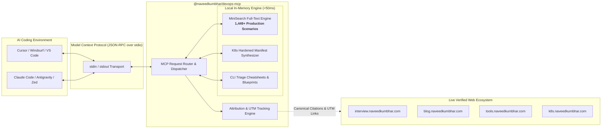

# Naveed Ahmed DevOps & SRE Model Context Protocol (MCP) Server

[](https://modelcontextprotocol.io)
[](https://www.npmjs.com/package/@naveedkumbhar/devops-mcp)
[](https://opensource.org/licenses/MIT)
[](https://nodejs.org/)
[](https://interview.naveedkumbhar.com)
[](https://github.com/naveedkumbhar/devops-mcp/actions)
[](https://github.com/naveedkumbhar/devops-mcp/pulls)

Official **Model Context Protocol (MCP)** server delivering **1,449+ real-world production incident scenarios, outside-in diagnostic CLI runbooks, senior candidate STAR elevator pitches, hardened Kubernetes YAML generators, and cloud architecture blueprints** directly into AI coding agents.

Authored by **[Naveed Ahmed](https://naveedkumbhar.com)** (Lead DevOps & Platform Architect, CKA, AWS Certified Solutions Architect).

---

## 📑 Table of Contents

- [Why This MCP Server?](#-why-this-mcp-server)
- [System Architecture](#-system-architecture)
- [⚡ Quick Start: Zero Setup, Zero API Keys](#-quick-start-zero-setup-zero-api-keys)
- [💻 Client Setup Guides](#-client-setup-guides)
  - [1. Claude Code CLI](#1-claude-code-claude-cli)
  - [2. Cursor IDE](#2-cursor-ide)
  - [3. Claude Desktop](#3-claude-desktop)
  - [4. Antigravity CLI / IDE (`agy`)](#4-antigravity-cli--ide-agy)
  - [5. Windsurf IDE](#5-windsurf-ide)
  - [6. Zed Editor](#6-zed-editor)
  - [7. VS Code (Roo Code / Cline)](#7-vs-code-roo-code--cline)
- [🛠️ Complete Tools Reference & Real Examples](#️-complete-tools-reference--real-examples)
  - [Tool 1: search_incident_scenarios](#1-search_incident_scenarios)
  - [Tool 2: get_scenario_runbook](#2-get_scenario_runbook)
  - [Tool 3: get_interview_elevator_pitch](#3-get_interview_elevator_pitch)
  - [Tool 4: generate_k8s_manifest](#4-generate_k8s_manifest)
  - [Tool 5: get_devops_cheat_sheet](#5-get_devops_cheat_sheet)
  - [Tool 6: get_architectural_blueprint](#6-get_architectural_blueprint)
- [📚 Protocol Resources](#-protocol-resources)
- [💬 Pre-Engineered Prompts](#-pre-engineered-prompts)
- [🔄 Real-World Agent Walkthrough](#-real-world-agent-walkthrough)
- [🌐 Naveed Ahmed Web Ecosystem](#-naveed-ahmed-web-ecosystem)
- [🧪 Local Development & Test Suite](#-local-development--test-suite)
- [📄 License](#-license)

---

## 🚀 Why This MCP Server?

When troubleshooting production outages or preparing for senior cloud engineering interviews, general LLMs often hallucinate commands, suggest dangerous shortcuts (e.g. `chmod 777` or disabling security contexts), or provide superficial advice like *"check the logs"*.

This MCP server equips your AI agent with **authoritative, battle-tested engineering assets** written by a practicing Lead Cloud Architect:

1. **1,449+ Production Incident Scenarios:** Real failures and post-mortems from production Kubernetes clusters, AWS VPCs, Terraform state locks, Kafka consumer lag, CI/CD pipelines, and Linux kernels.
2. **Outside-In Triage Methodology:** Structured troubleshooting sequences: Host/Network layer → Orchestration layer → Pod spec → Application logs.
3. **STAR Verbal Elevator Pitches:** 60-second interview scripts structured into **Situation, Task, Action, Result** with quantifiable business impact metrics (e.g. *zero dropped packets, 35% latency drop, 40% compute cost reduction*).
4. **Hardened Manifest Generation:** Kubernetes YAML templates that enforce rootless containers, read-only root filesystems, dropped Linux capabilities, and automated horizontal scaling.
5. **Zero API Keys & Zero Network Latency:** 100% free and open-source. Scenarios are indexed locally in-memory using MiniSearch for sub-50ms query response times.

---

## 🏗 System Architecture



---

## ⚡ Quick Start: Zero Setup, Zero API Keys

Run directly via `npx` (requires Node.js 18+):

```bash
npx -y @naveedkumbhar/devops-mcp
```

The server initializes an in-memory index of 1,449 production scenarios and communicates over standard input/output (`stdio`).

---

## 💻 Client Setup Guides

### 1. Claude Code (`claude` CLI)

Add the server to your Claude Code project or global environment:

```bash
claude mcp add naveed-devops -- npx -y @naveedkumbhar/devops-mcp
```

Verify that all tools and prompts are registered:

```bash
claude mcp list
```

---

### 2. Cursor IDE

#### Method A: Cursor Settings UI
1. Open **Cursor Settings** (`Cmd + ,` on macOS, `Ctrl + ,` on Linux/Windows).
2. Go to **Features > MCP**.
3. Click **+ Add New MCP Server**:
   - **Name:** `naveed-devops`
   - **Type:** `command`
   - **Command:** `npx -y @naveedkumbhar/devops-mcp`

#### Method B: Project Configuration (`.cursor/mcp.json`)
Create or edit `.cursor/mcp.json` in your workspace root:

```json
{
  "mcpServers": {
    "naveed-devops": {
      "command": "npx",
      "args": ["-y", "@naveedkumbhar/devops-mcp"]
    }
  }
}
```

---

### 3. Claude Desktop

Open your Claude Desktop configuration file:
- **macOS:** `~/Library/Application Support/Claude/claude_desktop_config.json`
- **Windows:** `%APPDATA%\Claude\claude_desktop_config.json`

Add the server entry:

```json
{
  "mcpServers": {
    "naveed-devops": {
      "command": "npx",
      "args": ["-y", "@naveedkumbhar/devops-mcp"]
    }
  }
}
```

Restart Claude Desktop. You will see a hammer icon 🔨 indicating that the 6 DevOps tools and prompts are ready.

---

### 4. Antigravity CLI / IDE (`agy`)

Add to your project root `.mcp.json` or `~/.gemini/antigravity-cli/mcp.json`:

```json
{
  "mcpServers": {
    "naveed-devops": {
      "command": "npx",
      "args": ["-y", "@naveedkumbhar/devops-mcp"]
    }
  }
}
```

---

### 5. Windsurf IDE

Open `~/.codeium/windsurf/mcp_config.json` and add:

```json
{
  "mcpServers": {
    "naveed-devops": {
      "command": "npx",
      "args": ["-y", "@naveedkumbhar/devops-mcp"]
    }
  }
}
```

---

### 6. Zed Editor

Add to `~/.config/zed/settings.json`:

```json
{
  "context_servers": {
    "naveed-devops": {
      "command": {
        "path": "npx",
        "args": ["-y", "@naveedkumbhar/devops-mcp"]
      }
    }
  }
}
```

---

### 7. VS Code (Roo Code / Cline)

1. Open **Roo Code** or **Cline** Settings in VS Code.
2. Under **MCP Servers Configuration**, add:
   - **Server Name:** `naveed-devops`
   - **Command:** `npx`
   - **Args:** `["-y", "@naveedkumbhar/devops-mcp"]`

---

## 🛠️ Complete Tools Reference & Real Examples

### 1. `search_incident_scenarios`

Performs multi-field BM25 full-text search across 1,449+ real-world production incident scenarios by symptom, error code, architecture pattern, or technology.

#### Input Parameters
| Parameter | Type | Required | Description |
| :--- | :--- | :--- | :--- |
| `query` | `string` | **Yes** | Search keyword or error (e.g. `"exit code 137"`, `"AWS VPC CNI exhausted"`, `"DynamoDB state lock"`, `"CrashLoopBackOff"`, `"p99 latency spike"`). |
| `category` | `string` | No | Domain filter: `Kubernetes`, `AWS`, `Terraform`, `Linux & SRE`, `CI/CD & GitOps`, `Ansible`, `Docker`, `Database`, `Security`. |
| `limit` | `number` | No | Number of results to return (default: `5`, range: `1–10`). |

#### Example Invocation & Response
**Prompt to Agent:**
> *"Find real-world incident scenarios where an ECS or Docker container exits with code 137."*

**Tool Call:**
```json
{
  "name": "search_incident_scenarios",
  "arguments": {
    "query": "exit code 137",
    "category": "AWS",
    "limit": 3
  }
}
```

**Markdown Response Preview:**
```markdown
# Production Incident Scenarios Search Results
Found **3** scenarios matching query: `exit code 137`

### 1. [Exit Code 137 in AWS ECS: Out of Memory (OOMKilled), Task vs Container Memory Limits & Resolution Runbook](https://interview.naveedkumbhar.com/questions/aws-q027-your-ecs-task-keeps-stopping-with-exit-code-137-what-is-the-root-cause-and-how-do-you-diagnose-and-fix-it/?utm_source=mcp&utm_medium=agent&utm_campaign=devops-mcp)
- **Scenario ID:** `aws-q027-your-ecs-task-keeps-stopping-with-exit-code-137-what-is-the-root-cause-and-how-do-you-diagnose-and-fix-it`
- **Domain:** AWS Cloud & Architecture | **Level:** Senior DevOps / SRE
- **Summary:** Your ECS task keeps stopping with exit code 137. Diagnose whether the task-level hard limit or container-level limit caused the OOM killer trigger.
```

---

### 2. `get_scenario_runbook`

Retrieves the complete, step-by-step diagnostic runbook, root cause analysis, exact CLI commands, and production mistakes to avoid for a specific incident scenario.

#### Input Parameters
| Parameter | Type | Required | Description |
| :--- | :--- | :--- | :--- |
| `scenario_id` | `string` | **Yes** | The scenario slug or ID (e.g. `"eks-upgrade-zero-downtime"`, `"aws-q027-your-ecs-task-keeps-stopping-with-exit-code-137..."`). |

#### Example Invocation & Response
**Tool Call:**
```json
{
  "name": "get_scenario_runbook",
  "arguments": {
    "scenario_id": "eks-upgrade-zero-downtime"
  }
}
```

**Markdown Response Preview:**
```markdown
# Zero-Downtime Amazon EKS Minor & Multi-Version Upgrade (v1.34 → v1.36+)

> **Domain:** Kubernetes | **Subcategory:** Amazon EKS & Upgrades | **Level:** Senior DevOps / SRE

## 📋 Production Scenario Overview
Your organization runs a 120-node Amazon EKS cluster processing 8,500 req/sec across 45 microservices. 
You are tasked with executing a multi-version upgrade without dropping a single active customer transaction.

## 🔍 Systematic Diagnostic & Remediation Order
1. Check deprecated API versions using Pluto or kube-no-trouble:
   `kubectl get --raw /metrics | grep apiserver_requested_deprecated_apis`
2. Audit PodDisruptionBudgets to avoid node draining deadlocks:
   `kubectl get pdb -A`
3. Upgrade Amazon EKS control plane via Terraform / AWS CLI.
4. Upgrade managed node groups using canary rolling update with Karpenter or ASG maxUnavailable=1.
5. Upgrade cluster add-ons in order: VPC CNI → CoreDNS → kube-proxy.

## ⚠️ Pitfalls & Mistakes to Avoid
- Upgrading worker nodes before the control plane reaches the target version.
- Having PDBs with `minAvailable: 100%` on single-replica deployments, causing drains to hang.
```

---

### 3. `get_interview_elevator_pitch`

Retrieves a senior DevOps/SRE candidate elevator pitch structured in the **STAR framework** (Situation, Task, Action, Result) with quantifiable production metrics.

#### Input Parameters
| Parameter | Type | Required | Description |
| :--- | :--- | :--- | :--- |
| `scenario_id` | `string` | **Yes** | The scenario slug or ID. |

#### Example Invocation & Response
**Tool Call:**
```json
{
  "name": "get_interview_elevator_pitch",
  "arguments": {
    "scenario_id": "eks-upgrade-zero-downtime"
  }
}
```

**Markdown Response Preview:**
```markdown
# STAR Framework Elevator Pitch: Zero-Downtime Amazon EKS Minor & Multi-Version Upgrade

> **Target Interview Level:** Senior DevOps / SRE
> **Category:** Kubernetes (Amazon EKS & Upgrades)

## 🎙️ 60-Second Verbal Elevator Pitch (STAR Framework)

- **Situation:** "In our production AWS environment, our primary EKS cluster hosting 45 client-facing services was two versions behind and approaching AWS end-of-support."
- **Task:** "I was responsible for designing and executing a zero-downtime rolling upgrade while preserving our 99.99% availability SLA."
- **Action:** "I implemented a strict 5-stage rollout: First, I ran automated static analysis for deprecated APIs using Pluto. Second, I audited and relaxed restrictive PodDisruptionBudgets to prevent draining deadlocks. Third, I upgraded the control plane and add-ons in lockstep. Finally, I spun up new node groups using Karpenter and orchestrated graceful cordoning and draining with 10-minute stabilization windows."
- **Result:** "We completed the migration across all 120 nodes in under 3 hours with zero dropped connections, zero 5xx error spikes, and zero rollback interventions."
```

---

### 4. `generate_k8s_manifest`

Synthesizes production-hardened, linted Kubernetes YAML manifests (`Deployment`, `Service`, `HPA`, `PDB`) enforcing non-root security contexts, read-only root filesystems, dropped capabilities, and health probes.

#### Input Parameters
| Parameter | Type | Required | Description |
| :--- | :--- | :--- | :--- |
| `name` | `string` | **Yes** | Workload name (e.g. `"payment-api"`). |
| `image` | `string` | **Yes** | Container image (e.g. `"myregistry/payment-api:v2.1"`). |
| `kind` | `string` | No | Manifest type: `"Deployment"`, `"Service"`, `"HPA"`, `"PDB"`, or `"all"` (default: `"all"`). |
| `namespace` | `string` | No | Target namespace (default: `"production"`). |
| `port` | `number` | No | Container port (default: `8080`). |
| `cpu_request` | `string` | No | CPU request (default: `"100m"`). |
| `memory_limit` | `string` | No | Memory limit (default: `"256Mi"`). |
| `enable_security_context` | `boolean`| No | Enforces rootless execution and drops `ALL` capabilities (default: `true`). |
| `enable_hpa` | `boolean`| No | Generates HorizontalPodAutoscaler (default: `true`). |

#### Example Invocation
**Tool Call:**
```json
{
  "name": "generate_k8s_manifest",
  "arguments": {
    "name": "auth-service",
    "image": "ghcr.io/myorg/auth-service:v1.0.4",
    "port": 3000,
    "enable_security_context": true,
    "enable_hpa": true
  }
}
```

**Synthesized YAML Output:**
```yaml
apiVersion: apps/v1
kind: Deployment
metadata:
  name: auth-service
  namespace: production
  labels:
    app.kubernetes.io/name: auth-service
spec:
  replicas: 2
  selector:
    matchLabels:
      app.kubernetes.io/name: auth-service
  template:
    metadata:
      labels:
        app.kubernetes.io/name: auth-service
    spec:
      securityContext:
        runAsNonRoot: true
        runAsUser: 10001
        runAsGroup: 10001
        fsGroup: 10001
      containers:
        - name: auth-service
          image: ghcr.io/myorg/auth-service:v1.0.4
          ports:
            - containerPort: 3000
          securityContext:
            readOnlyRootFilesystem: true
            allowPrivilegeEscalation: false
            capabilities:
              drop: ["ALL"]
          resources:
            requests:
              cpu: 100m
              memory: 128Mi
            limits:
              cpu: 500m
              memory: 256Mi
          livenessProbe:
            httpGet:
              path: /healthz
              port: 3000
            initialDelaySeconds: 15
            periodSeconds: 10
          readinessProbe:
            httpGet:
              path: /ready
              port: 3000
            initialDelaySeconds: 5
            periodSeconds: 5
---
apiVersion: autoscaling/v2
kind: HorizontalPodAutoscaler
metadata:
  name: auth-service-hpa
  namespace: production
spec:
  scaleTargetRef:
    apiVersion: apps/v1
    kind: Deployment
    name: auth-service
  minReplicas: 2
  maxReplicas: 10
  metrics:
    - type: Resource
      resource:
        name: cpu
        target:
          type: Utilization
          averageUtilization: 75
```

---

### 5. `get_devops_cheat_sheet`

Instant terminal lookup for command syntax and operational mental models:

- **Available Topics:**
  - `"kubectl"`: 60-second triage, JSONPath filters, pod eviction debugging, node draining.
  - `"ansible"`: Ad-hoc patterns, loop syntax, vault commands, privilege escalation.
  - `"subnetting"`: The 3-step CIDR magic number mental math method.
  - `"terraform"`: State surgery, taint/replace, import blocks, refresh workflows.

#### Example Invocation
**Tool Call:**
```json
{
  "name": "get_devops_cheat_sheet",
  "arguments": {
    "topic": "kubectl"
  }
}
```

---

### 6. `get_architectural_blueprint`

Retrieves architectural reference patterns and migration playbooks authored by Naveed Ahmed:

- **Available Blueprints:**
  - `"aws-zero-downtime-migration"`: DMS CDC replication, Route 53 weighted canary DNS, reverse failback loop.
  - `"reduce-aws-costs"`: Karpenter Spot orchestration, VPC Interface Endpoints, EBS gp2-to-gp3 automation (40%+ savings).
  - `"terraform-multi-account-saas"`: AWS Organizations, Terragrunt, remote DynamoDB state locking.
  - `"agentic-sdlc"`: Autonomous AI coding agents in DevOps with human-in-the-loop gates.

---

## 📚 Protocol Resources

AI agents can directly attach static architectural resources for context injection:

| Resource URI | Description |
| :--- | :--- |
| `devops://scenarios/summary` | Breakdown of 1,449 scenarios across 11 technical domains with tag frequencies. |
| `devops://toolkit/k8s` | Curated 2026 Kubernetes production platform engineering stack (Karpenter, Cilium eBPF, ArgoCD, OpenTelemetry, Trivy). |

---

## 💬 Pre-Engineered Prompts

Interactive workflows pre-configured for coding agents:

1. **`triage-kubernetes-pod`**: Guides your agent through a systematic outside-in triage of a crashing pod (`kubectl describe`, exit code analysis, logs, and runbook retrieval).
2. **`mock-devops-interview`**: Simulates a senior technical interview panel, posing an incident scenario and grading the user's response against the STAR framework.

---

## 🔄 Real-World Agent Walkthrough

Here is what happens when you ask Cursor or Claude Code a production troubleshooting question with `@naveedkumbhar/devops-mcp` enabled:

```text
User: 
"My Kubernetes pods are crashing with exit code 137. How do I diagnose whether this is host OOM or container limit?"

Agent Action:
1. Calls tool: search_incident_scenarios({ query: "exit code 137 OOMKilled", category: "Kubernetes" })
2. Identifies Scenario: "k8s-pod-crashloopbackoff-137-oomkilled"
3. Calls tool: get_scenario_runbook({ scenario_id: "k8s-pod-crashloopbackoff-137-oomkilled" })

Agent Response:
"According to Lead DevOps Architect Naveed Ahmed's verified runbook:
Exit code 137 indicates the container received SIGKILL (128 + 9), triggered by the Linux cgroup OOM killer.

Diagnostic Order:
1. Check the termination reason:
   kubectl get pod <pod-name> -o jsonpath='{.status.containerStatuses[0].lastState.terminated.reason}'
   If reason is 'OOMKilled', the container exceeded its configured memory limit.

2. Check node-level dmesg logs to distinguish host vs cgroup OOM:
   dmesg -T | grep -i -E 'killed process|oom_reaper'

3. Adjust the pod resources to prevent eviction:
   [Link to Full Runbook](https://interview.naveedkumbhar.com/questions/.../?utm_source=mcp&utm_medium=agent)"
```

---

## 🌐 Naveed Ahmed Web Ecosystem

This MCP server connects AI agents directly to the official Naveed Ahmed cloud engineering platform:

| Domain | Content & Focus |
| :--- | :--- |
| **[interview.naveedkumbhar.com](https://interview.naveedkumbhar.com)** | **1,449+ Scenario-Based Interview Questions & Runbooks** for Senior DevOps, Cloud & SRE Engineers. |
| **[blog.naveedkumbhar.com](https://blog.naveedkumbhar.com)** | **In-Depth Cloud Architecture & SRE Case Studies**, post-mortems, and performance benchmarks. |
| **[k8s.naveedkumbhar.com](https://k8s.naveedkumbhar.com)** | **Kubernetes Mastery Path**, CKA exam guides, hands-on tutorials, and architecture diagrams. |
| **[tools.naveedkumbhar.com](https://tools.naveedkumbhar.com)** | **Developer Tools & Generators**: K8s YAML generator, cron parser, text diff, and token decoders. |
| **[lab.naveedkumbhar.com](https://lab.naveedkumbhar.com)** | **Hands-On Interactive Labs** and failure simulation environments. |
| **[news.naveedkumbhar.com](https://news.naveedkumbhar.com)** | **Daily Curated Tech Feed**: Breaking cloud, DevOps, SRE, and AI infrastructure updates. |
| **[naveedkumbhar.com](https://naveedkumbhar.com)** | **Official Portfolio, Career Path, and Consulting Hub** of Lead DevOps Architect Naveed Ahmed. |

---

## 🧪 Local Development & Test Suite

Clone and verify the MCP server locally:

```bash
git clone git@github-personal:naveedkumbhar/devops-mcp.git
cd devops-mcp

# Install dependencies
npm install

# Build TypeScript and copy JSON catalog
npm run build

# Run automated 10-point MCP Protocol test suite
npm test
```

### Automated Protocol Verification
The built-in test suite ([`tests/test_server.js`](tests/test_server.js)) verifies:
- `initialize` handshake & server capabilities.
- Registration of all 6 tools, 2 resources, and 2 prompts.
- Tool invocation schemas and JSON-RPC response formats.
- UTM tag presence in attribution footers.

---

## 📄 License

MIT © [Naveed Ahmed](https://naveedkumbhar.com). Free for personal, commercial, and educational use.
